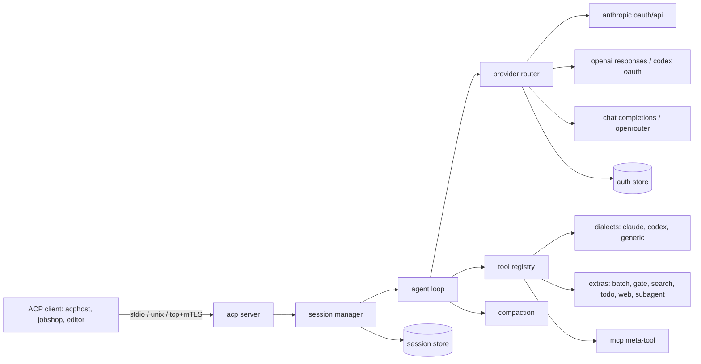

# acpharness design

acpharness is a Go coding agent that speaks the Agent Client Protocol (ACP). It runs Claude and Codex models with their upstream tool shapes over the user's subscriptions, other models over OpenAI-compatible APIs, and adds a small set of jcode harness features. It targets hundreds of concurrent sessions per Linux host, run directly or behind acphost.

Status: draft, 2026-11-11. Decisions come from four Q&A rounds with the user.

## Goals

- ACP compliant agent: `initialize`, `authenticate`, `session/new`, `session/load`, `session/prompt`, `session/cancel`, `session/set_model`, `session/set_mode`, `session/request_permission`, `session/update` with plans, tool calls, thoughts, commands and usage.
- Does real coding tasks locally as well as jcode does in a single session.
- Low footprint per session: idle sessions use no CPU and little memory.
- Claude OAuth, Codex OAuth, OpenAI Chat Completions and Responses, OpenRouter.
- Upstream tool shapes and system prompts per model family, pinned by version.

## Non-goals (v1)

- TUI, macOS, sandboxing or isolation (wrappers such as acphost do that), swarm (leave room), self-learning or memory.

## First milestone

The agent completes coding tasks locally with quality comparable to jcode and passes ACP compliance checks with a real ACP client (acphost and the `acp-go-sdk` client). jobcity integration and footprint comparison come after.

## Architecture



Packages:

| package | role |
|---|---|
| `cmd/acpharness` | CLI: `serve` (default, stdio), `login`, `logout`, `accounts`, `config`, `models` |
| `internal/config` | koanf loading and the typed config |
| `internal/acp` | ACP server on `coder/acp-go-sdk`, transports, update mapping |
| `internal/session` | session lifecycle, modes, model switching, cancel |
| `internal/loop` | one prompt turn: stream, tool dispatch, limits, hooks |
| `internal/provider` | provider interface, router, fallback, retry |
| `internal/provider/{anthropic,openai,chat}` | wire clients |
| `internal/auth` | account store, OAuth login and refresh, file locking |
| `internal/tools` | registry, dialect selection, output gating |
| `internal/tools/{claude,codex,generic,extras}` | tool sets |
| `internal/mcp` | MCP client: stdio, streamable HTTP, legacy SSE, OAuth |
| `internal/compact` | reactive, proactive, semantic, OpenAI native |
| `internal/context` | AGENTS.md, skills, extra files and directories |
| `internal/store` | store interface and backends |
| `internal/telemetry` | OTel traces and metrics, slog handlers |
| `prompts/` | pinned upstream prompts and tool schemas, embedded |

`internal/` while APIs settle. Anything jobshop should import moves to `pkg/` deliberately.

## Process and transports

- One process can host many sessions. The default is one process per stdio connection, which is what acphost spawns.
- Listeners: stdio (default), unix socket, TCP. TCP and unix support TLS with optional client certificate verification (mTLS) from config.
- A listener process serves many connections, each with its own sessions. Sessions in one process share the provider HTTP pool, auth store, MCP connections where config marks a server shared, and the prompt and schema caches.
- Idle cost: no goroutine wakes while a session waits for a prompt. No polling timers. Timers start only for active turns, retries and refreshes.

## Configuration

koanf, layered in this order, each later layer overriding earlier:

1. Built-in defaults.
2. `/etc/acpharness/config.{toml,yaml,json}`.
3. `$XDG_CONFIG_HOME/acpharness/config.*`.
4. Files listed in `ACPHARNESS_CONFIG` (path list, `:`-separated), and `--config` flags (repeatable).
5. Environment `ACPHARNESS_*`, `__` as the nesting separator (`ACPHARNESS_LIMITS__MAX_TOOL_CALLS=200`).
6. CLI flags.
7. Per-session overrides from `session/new` `_meta.acpharness` (allowlisted keys only: model, context files, skills dirs, limits, mode, mcp servers, compaction).

`acpharness config` prints the resolved config with secrets redacted and the source of each key.

Sketch:

```toml
default_model = "opus"

[models.opus]
chain = ["claude:work/claude-opus-4-7", "claude:personal/claude-opus-4-7", "openrouter:main/anthropic/claude-opus-4.7"]

[models.gpt]
chain = ["codex:work/gpt-5.5"]

[[accounts]]
id = "work"
provider = "claude"
kind = "oauth"

[[accounts]]
id = "main"
provider = "openrouter"
kind = "api_key"
api_key_env = "OPENROUTER_API_KEY"

[[providers]]
id = "zai"
kind = "chat"            # chat | responses
base_url = "https://api.z.ai/api/coding/paas/v4"

[context]
agents_files = true
extra_files = []
extra_dirs = []
skills_dirs = ["~/.agents/skills"]

[limits]
max_tool_calls = 0       # 0 = unlimited
max_wall = "0s"
max_tokens = 0
subagent_depth = 2
subagent_concurrency = 4

[compaction]
mode = "reactive"        # reactive | proactive | semantic | off
openai_native = "auto"   # auto | explicit | off

[[hooks]]
event = "pre_tool"       # pre_tool | post_tool | prompt | stop
tools = ["Bash", "shell"]
command = ["/usr/local/bin/check-cmd"]

[[mcp.servers]]
name = "linear"
transport = "streamable_http"   # stdio | streamable_http | sse
url = "https://mcp.linear.app/mcp"

[telemetry]
otel = true
logs.stderr.level = "info"
logs.stderr.format = "text"
logs.otel.level = "debug"
```

Defaults for limits and compaction thresholds start from jcode's measured defaults and are documented with their source.

## Providers and auth

### Provider interface

One streaming interface returning a normalized event stream: text deltas, thinking deltas (with signatures where the API has them), tool call starts, argument deltas, tool call ends, usage, stop reason, and provider-native items that must round-trip (Anthropic thinking signatures, OpenAI encrypted reasoning, compaction items).

Wire clients:

- `anthropic`: Messages API, streaming, OAuth or API key. OAuth identity follows jcode (`docs/ANTHROPIC_OAUTH_IDENTITY_PROBE_2026_11_05.md` in jcode): Claude CLI user agent, jcode's OAuth beta header set, `x-app: cli`, session id, and the `x-anthropic-billing-header` system block, which Anthropic strips server-side. Without the billing block or an SDK identity sentence, Opus and Sonnet OAuth requests get HTTP 429. The prompt names the agent as acpharness, not Claude Code or the Agent SDK. Constants track jcode's and are re-probed on change.
- `openai`: Responses API, streaming. Codex OAuth through `chatgpt.com/backend-api/codex` with the Codex instructions. jcode's 2026-11-05 probe found the backend accepts any `originator`, so acpharness sends `acpharness`. API keys against `api.openai.com` or any Responses-compatible endpoint. Native compaction.
- `chat`: Chat Completions, streaming, for OpenRouter, z.ai, DeepSeek, OpenCode Go and others. OpenRouter extras: provider routing preferences, reasoning parameters, `HTTP-Referer` and `X-Title`.

Model metadata (context window, max output, reasoning support, family, tool dialect) comes from a pinned table plus provider model listings (`/models` on OpenRouter), with config overrides. An unknown model with no metadata is an error at selection time, not a silent default.

### Accounts and fallback

- Accounts live in the auth store, `$XDG_STATE_HOME/acpharness/auth/<account>.json`, mode 0600.
- `acpharness login claude --account work` and `acpharness login codex --account work` run the upstream OAuth flows: browser with a local callback, or a device or manual code paste for headless hosts.
- Refresh: take an `flock` on the account file, re-read it, refresh only if the token is still expired, write atomically (temp file and rename), release. Hundreds of processes share one refresh.
- Model chains: each named model is an ordered list of `provider:account/model`. The router tries the next entry on rate limit, quota exhaustion, auth failure or overload, after retries on the current entry are exhausted. Fallback moves are reported to the client.
- Retry: exponential backoff with jitter, honoring `retry-after` and provider reset headers. Policy in config.
- Rate-limit state is per account and shared in process. Cross-process sharing is a later option (a small file or broker) if contention shows up.

### Runtime model selection

- `session/new` uses `_meta` or the configured default.
- `session/set_model` switches between turns. A switch that changes tool dialect rewrites prior tool calls into the new dialect's neutral form only where the provider requires it; provider-native items that cannot transfer (thinking signatures, encrypted reasoning) are dropped with a recorded event, never sent to the wrong provider.
- Subagent spawns may name a model or chain.

## Tools

### Dialects

| family | dialect | tools |
|---|---|---|
| Claude | `claude` | upstream Claude Code: Bash, Read, Write, Edit, MultiEdit, Glob, Grep, WebFetch, WebSearch, TodoWrite, Task, NotebookEdit |
| GPT, Codex | `codex` | upstream Codex: shell, apply_patch, update_plan, view_image, web_search, spawn_agent |
| other | resolved | the dialect of the family the model was distilled from when known, else `generic` |

`generic` is the Claude Code shapes with neutral descriptions. Config can pin a dialect per model. Upstream prompts and schemas are copied into `prompts/<upstream>/<version>/` with the source commit, and a script diffs them against new upstream releases.

### Extras (on by default, each can be disabled)

- Parallel execution of tool calls emitted in one message. Read-only tools run concurrently; writes to the same path serialize.
- `batch`: run several independent tool calls in one call, for models that do not emit parallel calls.
- Output gating: results over a configured token budget return a summary with the estimated size; re-running with `accept_large_output` returns the full result.
- Search: an agentgrep-style tool with grep, find, outline and trace modes, built on ripgrep's Go-native equivalents or the `rg` binary when present.
- Todo: maps to ACP `plan` updates. Uses TodoWrite or update_plan shapes in their dialects.
- Web: webfetch with HTML to Markdown. Web search uses the provider's built-in server tool (Anthropic web search, OpenAI Responses web search, OpenRouter web plugin). Users who want an external backend add a tool or an MCP server.
- Subagent: see below.

Not in v1: background shell tasks.

### Subagents

Same model as jcode: the tool runs a child agent loop in the same process. The child shares the tool registry, MCP connections, context and provider pool, and gets its own transcript and compaction state. It may use a different model or chain. The parent receives the child's final message. Depth and concurrency limits come from config. Child activity streams to the client as nested tool call updates under the parent's tool call. Swarm, with separate sessions, comes later on the same session manager.

### MCP

- Transports: stdio, streamable HTTP, legacy HTTP+SSE. OAuth for remote servers with tokens in the auth store.
- Servers come from config and from `session/new` `mcpServers`, merged by name with the session winning.
- One `mcp` meta-tool with `list`, `search` (names and descriptions) and `call`. Schemas are returned on search, not loaded into the prompt.
- Connections start lazily on first use and close after an idle period from config.

### Permissions and modes

- Modes: `auto` (default, allow all, like jcode) and `ask` (routes `session/request_permission` for tools marked writing or executing). Exposed through ACP session modes.
- Slash commands through `available_commands`: `/compact`, `/model`, `/mode`, `/cost`.

### Hooks

Config maps an event and a tool set to a command. The command gets the event as JSON on stdin and returns JSON: allow, deny with reason, or modified input. Events: `pre_tool`, `post_tool`, `prompt`, `stop`. Timeouts come from config.

### Limits

Per-prompt limits from config or `_meta`: max tool calls, wall time, input and output tokens, subagent depth and concurrency. Hitting a limit ends the turn with a stop reason the client can see. Cancellation through `session/cancel` stops the stream, kills running tool processes by process group, and records the outcome of each in-flight tool as completed, cancelled or unknown.

## Compaction

Ported from jcode:

- `reactive`: compact in the background when context reaches a fraction or a token count, with emergency hard compaction when a request would not fit.
- `proactive`: project growth with EWMA over a lookahead window, with floor, sample, stall and cooldown settings.
- `semantic`: topic-shift detection and relevance keeping with embeddings from a configured embedding provider (see Embeddings).
- `off`: stop the turn with a context-full reason.
- OpenAI native: `auto` (server-side compaction at a token threshold), `explicit` (call the compact endpoint at the threshold), `off`.
- `max_context_tokens` caps the budget below the model window.
- `/compact` triggers manually. Compaction events go to the client in `_meta`.

## Embeddings

One client for the OpenAI `/v1/embeddings` shape, configured by base URL, model, account and dimensions. No in-process model. Local embeddings run as a sidecar that serves the same API: Ollama, llama.cpp `llama-server --embedding`, Hugging Face TEI, or Infinity. Hosted options use the same client: OpenAI, OpenRouter, Voyage, Jina, Mistral, Gemini through its OpenAI-compatible endpoint. Providers with a different wire shape get an adapter only when needed.

Recommended sidecar: Hugging Face Text Embeddings Inference (TEI). It runs any supported Hub model by id and serves OpenAI-compatible `/v1/embeddings`:

```sh
docker run -d -p 8080:80 -v $HOME/.cache/tei:/data \
  ghcr.io/huggingface/text-embeddings-inference:cpu-latest \
  --model-id BAAI/bge-small-en-v1.5
```

```toml
[embeddings]
base_url = "http://127.0.0.1:8080/v1"
model = "BAAI/bge-small-en-v1.5"
```

## Jev decisions

A configured Jev endpoint backs a native `jev_decision` tool and skill: bounded choice among supplied options, with state treated as untrusted data, matching jcode's tool shape and limits. Routes follow jcode: OpenRouter decisions, TypeSafe direct, AIMLAPI, or a custom base URL. Jev serves decisions only, not embeddings, so embeddings stay a separate config. Harness features may use Jev later (skill suggestion, subagent model routing) behind config.

```toml
[jev]
route = "openrouter"     # openrouter | typesafe | aimlapi | custom
model = "typesafe/jev-1.13"
account = "main"
```

## Context loading

- AGENTS.md (and CLAUDE.md for Claude dialect) from the working directory up to the repository root, plus the global file.
- Skills: directories with `SKILL.md`, listed by name and description in the system prompt and loaded on demand by a `skill` tool.
- Extra files and directories from config or `_meta`.

## Sessions and storage

Store interface:

```go
type Store interface {
    Create(ctx context.Context, meta SessionMeta) error
    Append(ctx context.Context, id SessionID, events []Event) error
    Load(ctx context.Context, id SessionID) (SessionMeta, EventIter, error)
    Snapshot(ctx context.Context, id SessionID, s Snapshot) error
    List(ctx context.Context, filter Filter) ([]SessionMeta, error)
    Delete(ctx context.Context, id SessionID) error
}
```

- Events are the canonical transcript: messages, tool calls and results, provider-native items, model switches, compaction summaries.
- `Snapshot` stores the compacted state so `Load` reads the latest snapshot plus events after it, not the whole history.
- Backends to evaluate with a benchmark harness (write amplification, fsyncs per turn, load time, size): JSONL with zstd frames, a length-prefixed binary log with periodic snapshots, SQLite in WAL mode, and Postgres for hosts that already run it. The first backend chosen by measurement becomes the default.
- Large tool outputs are stored by content hash outside the event log and referenced.
- `session/load` replays history to the client as `session/update` notifications, per ACP.

## ACP mapping

| internal | ACP |
|---|---|
| text delta | `agent_message_chunk` |
| thinking delta | `agent_thought_chunk` |
| tool call | `tool_call` with kind, title, locations, raw input; `tool_call_update` with status, content, diffs |
| todo | `plan` |
| commands | `available_commands_update` |
| mode | `current_mode_update` |
| usage, cost, active account and model, fallback, compaction, limit hit | `_meta.acpharness` on the relevant update, and the prompt response `_meta` |

Stop reasons map to ACP `end_turn`, `max_tokens`, `max_turn_requests`, `refusal`, `cancelled`.

## Telemetry

- OpenTelemetry traces: span per prompt turn, provider request (model, account, tokens, retries, fallback), tool call, MCP call, compaction, subagent.
- Metrics: active sessions, turns, tokens by provider, account and model, cost, request latency, retries, fallbacks, tool latency and errors, compaction counts, RSS and goroutines.
- slog for logs. Stderr handler and OTel log handler are configured separately (level, format, enabled). Trace and span IDs are attached to records.
- OTLP endpoint and headers through the standard `OTEL_*` environment variables plus config.

## Release

- Private repo `gfx-labs/acpharness`, Go module `github.com/gfx-labs/acpharness`.
- release-please, static binaries (`CGO_ENABLED=0`, linux amd64 and arm64), Nix flake with the package and a NixOS or home-manager module later.
- Dependencies: `coder/acp-go-sdk` (same version line as jobshop), koanf, OTel Go SDK, the official MCP Go SDK, an embedded ripgrep alternative or `rg`. New dependencies need a reason in the PR.

## Validation

- ACP compliance: a conformance suite driving the agent through `acp-go-sdk` as a client over each transport (initialize, new, prompt, cancel mid-tool, load and replay, set_model, set_mode, permission in ask mode).
- Providers: recorded real responses per provider for the stream parser, plus live smoke checks behind an env flag.
- Task quality: a set of local coding tasks run against acpharness and jcode with the same model, comparing completion, turns, tokens and wall time.
- Footprint: RSS and CPU for 1, 10 and 200 idle and active sessions, compared with jcode, measured by a reproducible script.

## Implementation order

1. Repo scaffold, config, slog and OTel, ACP server on stdio with `initialize`, `session/new`, `session/prompt`, `session/cancel`, and a stub loop.
2. Chat Completions provider (OpenRouter), generic dialect, agent loop with parallel tools, limits, cancellation. First real tasks run here.
3. Anthropic provider with OAuth login, refresh and locking, Claude dialect with pinned prompts.
4. Responses provider with Codex OAuth, Codex dialect, native compaction.
5. Model chains, fallback, retries, `session/set_model`, usage and cost reporting.
6. Session store interface with a first backend, `session/load`, store benchmark.
7. Extras: batch, output gating, search, todo and plan, web, subagents.
8. MCP meta-tool with all three transports and OAuth.
9. Compaction modes, embeddings client, Jev decisions, hooks, modes, slash commands, context loading options.
10. Unix and TCP listeners with mTLS, multi-session process mode.
11. Conformance suite, task quality comparison, footprint benchmark, then jobcity trial.

## Open questions

- Store default, decided by the benchmark in step 6.
- Web search for chat providers without a built-in tool: none by default, user-supplied tool or MCP.
