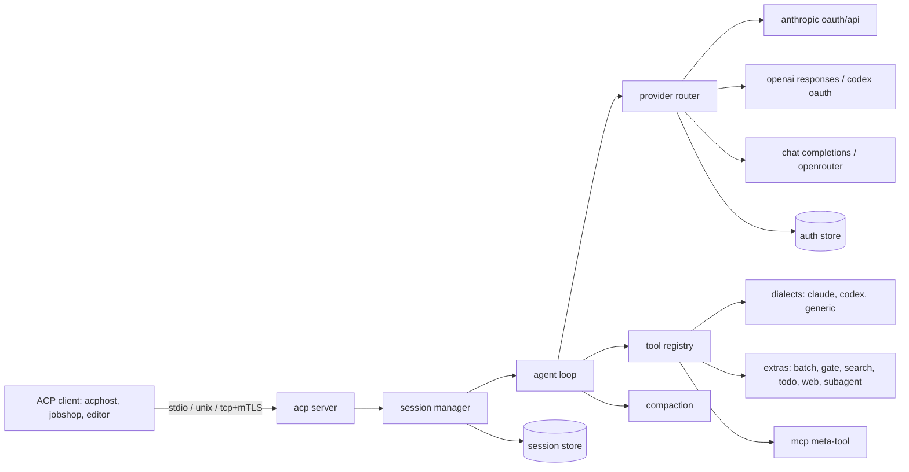

# acpharness design

acpharness is a Go coding agent that speaks the Agent Client Protocol (ACP). It runs Claude and Codex models with their upstream tool shapes over the user's subscriptions, other models over OpenAI-compatible APIs, and adds a small set of jcode harness features. It targets hundreds of concurrent sessions per Linux host, run directly or behind acphost.

Status: draft, 2026-11-11. Decisions come from four Q&A rounds with the user.

## Goals

- ACP compliant agent: `initialize`, `authenticate`, `session/new`, `session/load`, `session/prompt`, `session/cancel`, `session/set_config_option` (model, mode, thought level), `session/set_mode`, `session/request_permission`, `session/update` with plans, tool calls, thoughts, commands and usage. Method names follow the pinned ACP schema, which has no `session/set_model`.
- Does real coding tasks locally as well as jcode does in a single session.
- Low footprint per session: idle sessions use no CPU and little memory.
- Claude OAuth, Codex OAuth, OpenAI Chat Completions and Responses, OpenRouter.
- Upstream tool shapes and system prompts per model family, pinned by version.

## Non-goals (v1)

- TUI, sandboxing or isolation (wrappers such as acphost do that), swarm (leave room), self-learning or memory.
- macOS as a tested platform. It is a headless build target only: the tree must cross-build for `darwin/arm64`, because iOS captures run on a Mac.

## First milestone

The agent completes coding tasks locally with quality comparable to jcode and passes ACP compliance checks with real ACP clients (acphost, and jobshop's `acp-go-sdk` v0.13.5 client). jobcity integration and footprint comparison come after.

## Architecture



Packages:

| package | role |
|---|---|
| `cmd/acpharness` | a shim that calls `src/cli` |
| `src/cli` | CLI: `serve` (default, stdio), `login`, `logout`, `accounts`, `config`, `models`, `hosts` |
| `pkg/acp/harness` | what acpharness adds to ACP messages under `_meta.acpharness`, as types a client imports |
| `src/transcript` | the one conversation format shared by providers, tools and the store |
| `src/httpclient` | the one constructor for HTTP clients: proxy from the environment, system certificate pool |
| `src/config` | koanf loading and the typed config |
| `pkg/acp` | our ACP layer: JSON-RPC connection, types generated from the pinned schema, transports, update mapping |
| `src/session` | session lifecycle, modes, model switching, cancel |
| `src/loop` | one prompt turn: stream, tool dispatch, limits, hooks |
| `src/provider` | provider interface, router, fallback, retry |
| `src/provider/{anthropic,openai,chat}` | wire clients |
| `src/auth` | account store, OAuth login and refresh, file locking |
| `src/tools` | registry, dialect selection, output gating |
| `src/tools/{claude,codex,generic,extras}` | tool sets |
| `src/mcp` | MCP client: stdio, streamable HTTP, legacy SSE, OAuth |
| `src/compact` | reactive, proactive, semantic, OpenAI native |
| `src/agentctx` | AGENTS.md, skills, extra files and directories |
| `src/store` | store interface and backends |
| `src/telemetry` | OTel traces and metrics, slog handlers |
| `prompts/` | pinned upstream prompts and tool schemas, embedded |

`src/` holds packages while APIs settle. Packages move to `pkg/` when a real external caller needs them. `pkg/acp` moved on 2026-11-11: protocol7's worker imports it as the client side, so both ends share schema 1.31.0.

## Process and transports

- One process can host many sessions. The default is one process per stdio connection, which is what acphost spawns.
- Listeners: stdio (default), unix socket, TCP. TCP and unix support TLS with optional client certificate verification (mTLS) from config.
- A listener process serves many connections, each with its own sessions. Sessions in one process share the provider HTTP pool, auth store, MCP connections where config marks a server shared, and the prompt and schema caches.
- Idle cost: no goroutine wakes while a session waits for a prompt. No polling timers. Timers start only for active turns, retries and refreshes.

## Configuration

koanf, layered in this order, each later layer overriding earlier:

1. Built-in defaults.
2. `/etc/acpharness/config.{toml,yaml,json}`.
3. `$XDG_CONFIG_HOME/acpharness/config.*`.
4. Files listed in `ACPHARNESS_CONFIG` (path list, `:`-separated), and `--config` flags (repeatable).
5. Environment `ACPHARNESS_*`, `__` as the nesting separator (`ACPHARNESS_LIMITS__MAX_TOOL_CALLS=200`).
6. CLI flags, read from urfave/cli v3 by koanf's `cliflagv3` provider. A repeatable `--set key=value` reaches config keys without dedicated flags. Only explicitly supplied flags override earlier layers.
7. Per-session overrides from `session/new` `_meta.acpharness` (allowlisted keys only: model, context files, skills dirs, limits, mode, mcp servers, compaction).

koanf decodes the merged tree into one typed config struct. urfave/cli v3 defines commands and flags, and the application reads configuration only from the decoded struct. Flag names and environment names are mapped explicitly to the same canonical config keys.

`acpharness config` prints the resolved config with secrets redacted and the source of each key.

Sketch:

```toml
default_model = "opus"

[models.opus]
chain = ["claude:work/claude-opus-4-7", "claude:personal/claude-opus-4-7", "openrouter:main/anthropic/claude-opus-4.7"]

[models.gpt]
chain = ["codex:work/gpt-5.5"]

[[accounts]]
id = "work"
provider = "claude"
kind = "oauth"

[[accounts]]
id = "main"
provider = "openrouter"
kind = "api_key"
api_key_env = "OPENROUTER_API_KEY"

[[accounts]]
id = "pod"
provider = "claude"
kind = "proxied_oauth"   # oauth | api_key | proxied_oauth | proxied_api_key

[[providers]]
id = "zai"
kind = "chat"            # chat | responses
base_url = "https://api.z.ai/api/coding/paas/v4"

[context]
agents_files = true
extra_files = []
extra_dirs = []
skills_dirs = ["~/.agents/skills"]

[limits]
max_tool_calls = 0       # 0 = unlimited
max_wall = "0s"
max_tokens = 0
subagent_depth = 2
subagent_concurrency = 4

[compaction]
mode = "reactive"        # reactive | proactive | semantic | off
openai_native = "auto"   # auto | explicit | off

[[hooks]]
event = "pre_tool"       # pre_tool | post_tool | prompt | stop
tools = ["Bash", "shell"]
command = ["/usr/local/bin/check-cmd"]

[[mcp.servers]]
name = "linear"
transport = "streamable_http"   # stdio | streamable_http | sse
url = "https://mcp.linear.app/mcp"

[telemetry]
otel = true
logs.stderr.level = "info"
logs.stderr.format = "text"
logs.otel.level = "debug"
```

Defaults for limits and compaction thresholds start from jcode's measured defaults and are documented with their source.

## Providers and auth

### Provider interface

One streaming interface returning a normalized event stream: text deltas, thinking deltas (with signatures where the API has them), tool call starts, argument deltas, tool call ends, usage, stop reason, and provider-native items that must round-trip (Anthropic thinking signatures, OpenAI encrypted reasoning, compaction items). The stream is a Go iterator (`iter.Seq2[Event, error]`), as in `gfx-labs/sse`. A provider error is classified as one of three: retry the same chain entry, fall back to the next entry, or fail the turn.

Wire clients:

- `anthropic`: Messages API, streaming, OAuth or API key. OAuth identity follows jcode's code and its probe (`docs/ANTHROPIC_OAUTH_IDENTITY_PROBE_2026_11_05.md` in jcode). The one required piece is the `x-anthropic-billing-header` text sent as the first system block (`cc_version=2.1.280; cc_entrypoint=...; cch=33f85;`), which Anthropic strips server-side, with jcode's OAuth beta header set. Without that block, Opus and Sonnet OAuth requests get HTTP 429. jcode sends its own user agent (`jcode/<version>`) and no `x-app`, `X-Stainless-*` or Claude Code session headers, because the probe found none of them are needed. acpharness sends `acpharness/<version>`, and the prompt names the agent as acpharness. jcode's branches differ on `cc_entrypoint` (`sdk-cli` on origin/master 8e11eb23e, `jcode` on build 037163c7b), so step 3 re-runs the probe before choosing.
- `openai`: Responses API, streaming. Codex OAuth through `chatgpt.com/backend-api/codex` with the Codex instructions. jcode's 2026-11-05 probe found the backend accepts any `originator`, so acpharness sends `acpharness`. API keys against `api.openai.com` or any Responses-compatible endpoint. Native compaction.
- `chat`: Chat Completions, streaming, for OpenRouter, z.ai, DeepSeek, OpenCode Go and others. OpenRouter extras: provider routing preferences, reasoning parameters, `HTTP-Referer` and `X-Title`.

Model metadata (context window, max output, reasoning support, family, tool dialect) comes from a pinned table plus provider model listings (`/models` on OpenRouter), with config overrides. An unknown model with no metadata is an error at selection time, not a silent default.

### Accounts and fallback

- Accounts live in the auth store, `$XDG_STATE_HOME/acpharness/auth/<account>.json`, mode 0600.
- Proxy-held accounts (`proxied_oauth`, `proxied_api_key`): the harness never holds or refreshes the token. It sends a placeholder that names the account and builds the rest of the request exactly as for a token it held, including the Claude OAuth billing block and beta headers, because the proxy only swaps the authorization. Such an account has no file in the auth store, `login` refuses it, and a rejected credential is reported as an auth stop, since there is nothing to refresh.
- Every HTTP client honours `HTTPS_PROXY` and the system certificate pool: providers, the OpenAI WebSocket transport, remote MCP, webfetch, embeddings, Jev and OTLP. They all come from `src/httpclient`, lint forbids building a transport anywhere else, and one CI test runs a turn through a test proxy with its own CA.
- `acpharness hosts` lists the hosts the resolved config will contact (providers, OAuth endpoints, MCP servers, embeddings, Jev, OTLP), one per line with the config key that names it. It builds an egress allowlist without guessing. webfetch targets are chosen by the model and cannot be listed.
- `acpharness login claude --account work` and `acpharness login codex --account work` run the upstream OAuth flows: browser with a local callback, or a device or manual code paste for headless hosts.
- Refresh: take an `flock` on the account's lock file (`<account>.lock`, not the account file, since the rename that writes the account would leave a lock on the old inode), re-read the account, refresh only if the token is still expired, write atomically (temp file and rename), release. Hundreds of processes share one refresh.
- Model chains: each named model is an ordered list of `provider:account/model`. The router tries the next entry on rate limit, quota exhaustion, auth failure or overload, after retries on the current entry are exhausted. Fallback moves are reported to the client.
- Retry: exponential backoff with jitter, honoring `retry-after` and provider reset headers. Policy in config.
- Rate-limit state is per account and shared in process. Cross-process sharing is a later option (a small file or broker) if contention shows up.

### Runtime model selection

- `session/new` uses `_meta` or the configured default.
- `session/set_config_option` with the `model` category switches between turns. The session advertises its named models as a select option. A switch that changes tool dialect rewrites prior tool calls into the new dialect's neutral form only where the provider requires it; provider-native items that cannot transfer (thinking signatures, encrypted reasoning) are dropped with a recorded event, never sent to the wrong provider.
- Subagent spawns may name a model or chain.

## Tools

### Dialects

| family | dialect | tools |
|---|---|---|
| Claude | `claude` | the tools captured from the pinned Claude Code version |
| GPT, Codex | `codex` | the tools captured from the pinned Codex version |
| other | resolved | the dialect of the family the model was distilled from when known, else `generic` |

`generic` is the Claude Code shapes with neutral descriptions. Config can pin a dialect per model.

Each capability (read, write, edit, shell, search) has one implementation. A dialect adapter supplies the upstream tool name, schema, output text and error text. An adapter must behave as the upstream tool does, and is checked against outputs recorded from that upstream tool. Upstream prompts and schemas are copied into `prompts/<upstream>/<version>/` with the source commit, and a script diffs them against new upstream releases.

Upstream pins follow jcode: Claude Code 2.1.280, the version its billing block names, and openai/codex ce0323f2 (2026-10-17), the newest commit it cites for the OAuth contract. jcode sends its own tool names on the Claude OAuth path and carries no captured upstream tool schemas, so acpharness captures tool names, descriptions, schemas and system prompts from those two versions in steps 3 and 4. nanocode holds captures for Claude Code 2.1.304 and openai/codex c6e4438a with a verification script, usable as a cross-check.

### Extras (on by default, each can be disabled)

- Parallel execution of tool calls emitted in one message. Read-only tools run concurrently; writes to the same path serialize.
- `batch`: run several independent tool calls in one call, for models that do not emit parallel calls.
- Output gating: results over a configured token budget return a summary with the estimated size; re-running with `accept_large_output` returns the full result.
- Search: an agentgrep-style tool with grep, find, outline and trace modes. Text search requires the `rg` binary and reports a clear error when it is missing. Structural modes need a separately specified implementation, not a claimed ripgrep capability.
- Todo: maps to ACP `plan` updates. Uses TodoWrite or update_plan shapes in their dialects.
- Web: webfetch with HTML to Markdown. Web search uses the provider's built-in server tool (Anthropic web search, OpenAI Responses web search, OpenRouter web plugin). Users who want an external backend add a tool or an MCP server.
- Conversation search: a `conversation_search` tool with jcode's shape (`query`, `turns` range, `stats`). It reads the session's full stored history, including entries from before any compaction, not the compacted context the model currently sees. It can also read other sessions by id, so a parent can read the sessions of the subagents it spawned. Scope is a config setting: `self`, `descendants` (the session and every subagent session below it, the default) or `store` (every session in the store, opt-in because a shared store holds other workers' sessions). Keyword matching first. Result and snippet limits come from config.
- Argument repair: before validation, a tool input is repaired when a list or object argument arrives as a JSON string, a single object arrives where a list is declared, or a number or boolean arrives as a string. Each repair is counted in telemetry and logged, never silent. Anything else that fails the schema is returned to the model as an error.
- Subagent: see below.

Not in v1: background shell tasks.

### Subagents

Same model as jcode: the tool runs a child agent loop in the same process. The child shares the tool registry, MCP connections, context and provider pool, and gets its own compaction state. Its transcript is stored as its own session, with the parent session id in its metadata, so the parent can read it with conversation search. It may use a different model or chain. The parent receives the child's final message. Depth and concurrency limits come from config. Child activity streams to the client as nested tool call updates under the parent's tool call. Swarm, with separate sessions, comes later on the same session manager.

### MCP

- Transports: stdio, streamable HTTP, legacy HTTP+SSE. OAuth for remote servers with tokens in the auth store.
- Servers come from config and from `session/new` `mcpServers`, merged by name with the session winning.
- One `mcp` meta-tool with `list`, `search` (names and descriptions) and `call`. Schemas are returned on search, not loaded into the prompt.
- Direct tools: a server marked `direct` has its tools put in the prompt under their own names, not behind the meta-tool. A server named in `session/new` `mcpServers` is direct by default, since the client added it for this session and its tools (`submit_result`, `ask_human`) are used every turn. A config server is behind the meta-tool by default. A direct tool whose name collides with another tool is an error at session start.
- Connections start lazily on first use and close after an idle period from config.

### Permissions and modes

- Modes: `auto` (default, allow all, like jcode) and `ask` (routes `session/request_permission` for tools marked writing or executing). Exposed through ACP session modes.
- Slash commands through `available_commands`: `/compact`, `/model`, `/mode`, `/cost`.

### Hooks

Config maps an event and a tool set to a command. The command gets the event as JSON on stdin and returns JSON: allow, deny with reason, or modified input. Events: `pre_tool`, `post_tool`, `prompt`, `stop`. Timeouts come from config.

### Limits

Per-prompt limits from config or `_meta`: max tool calls, wall time, input and output tokens, subagent depth and concurrency. Hitting a limit ends the turn with a stop reason the client can see. Cancellation through `session/cancel` stops the stream, kills running tool processes by process group, and records the outcome of each in-flight tool as completed, cancelled or unknown.

### Interruption

- A `session/prompt` that arrives while a turn is running cancels that turn and starts the new one, as `acp-go-sdk` v0.13.5 does. The cancelled request returns the `cancelled` stop reason.
- After a cancel, every in-flight tool call gets a result saying it was cancelled, so no tool call is left without a result.
- The model is then told the turn was interrupted, with the dialect's upstream interruption message placed before the next user message. Codex: the `<turn_aborted>` message, which says the user interrupted on purpose and that aborted commands may have partly run. Claude Code: its request-interrupted message, to be confirmed against the pinned upstream version. Both texts are pinned with the other upstream prompts.

## Compaction

Ported from jcode:

- `reactive`: compact in the background when context reaches a fraction or a token count, with emergency hard compaction when a request would not fit.
- `proactive`: project growth with EWMA over a lookahead window, with floor, sample, stall and cooldown settings.
- `semantic`: topic-shift detection and relevance keeping with embeddings from a configured embedding provider (see Embeddings).
- `off`: stop the turn with a context-full reason.
- OpenAI native: `auto` (server-side compaction at a token threshold), `explicit` (call the compact endpoint at the threshold), `off`.
- `max_context_tokens` caps the budget below the model window.
- `/compact` triggers manually. Compaction is reported with `compaction_update` when the client advertises `session.compaction`, and as an ordinary agent message otherwise.
- Compaction appends an entry holding the summary and the id of the first kept entry. It never rewrites or deletes earlier entries, so conversation search can still read them.
- Two summary prompts, selected by `compaction.summary_prompt`: `checkpoint` (default, Pi's structured format with its merge prompt for later compactions) and `short` (jcode's). Either one tells the model it can search earlier history only when `conversation_search` is enabled.

## Embeddings

One client for the OpenAI `/v1/embeddings` shape, configured by base URL, model, account and dimensions. No in-process model. Local embeddings run as a sidecar that serves the same API: Ollama, llama.cpp `llama-server --embedding`, Hugging Face TEI, or Infinity. Hosted options use the same client: OpenAI, OpenRouter, Voyage, Jina, Mistral, Gemini through its OpenAI-compatible endpoint. Providers with a different wire shape get an adapter only when needed.

Recommended sidecar: Hugging Face Text Embeddings Inference (TEI). It runs any supported Hub model by id and serves OpenAI-compatible `/v1/embeddings`:

```sh
docker run -d -p 8080:80 -v $HOME/.cache/tei:/data \
  ghcr.io/huggingface/text-embeddings-inference:cpu-latest \
  --model-id BAAI/bge-small-en-v1.5
```

```toml
[embeddings]
base_url = "http://127.0.0.1:8080/v1"
model = "BAAI/bge-small-en-v1.5"
```

## Jev decisions

A configured Jev endpoint backs a native `jev_decision` tool and skill: bounded choice among supplied options, with state treated as untrusted data, matching jcode's tool shape and limits. Routes follow jcode: OpenRouter decisions, TypeSafe direct, AIMLAPI, or a custom base URL. Jev serves decisions only, not embeddings, so embeddings stay a separate config. Harness features may use Jev later (skill suggestion, subagent model routing) behind config.

```toml
[jev]
route = "openrouter"     # openrouter | typesafe | aimlapi | custom
model = "typesafe/jev-1.13"
account = "main"
```

## System prompt

The prompt is built from named sections in a fixed order: the dialect's upstream prompt, tools, rules, project context, skills, working directory, and any sections added by config. ACP `systemPrompt` on `session/new` maps onto them: `append` adds a section, and `override` replaces the default instruction sections and leaves tools, MCP servers and permissions alone. An unsupported mode is an error. Appending a changed section mid-session to keep the prompt cache is deferred until a measurement shows sections change mid-session.

## Context loading

- AGENTS.md (and CLAUDE.md for Claude dialect) from the working directory up to the repository root, plus the global file.
- Skills: directories with `SKILL.md`, listed by name and description in the system prompt and loaded on demand by a `skill` tool.
- Extra files and directories from config or `_meta`.

## Sessions and storage

Store interface:

```go
type Store interface {
    Create(ctx context.Context, meta SessionMeta) error
    Append(ctx context.Context, id SessionID, events []Event) error
    Load(ctx context.Context, id SessionID) (SessionMeta, EventIter, error)
    History(ctx context.Context, id SessionID, r EntryRange) (EventIter, error)
    Snapshot(ctx context.Context, id SessionID, s Snapshot) error
    List(ctx context.Context, filter Filter) ([]SessionMeta, error)
    Delete(ctx context.Context, id SessionID) error
}
```

- Events are the canonical transcript: messages, tool calls and results, provider-native items, model switches, compaction summaries.
- One internal message format for every provider. Items only one provider understands (thinking signatures, encrypted reasoning) are stored as opaque blobs tagged with that provider, and are sent back only to it.
- Session and entry ids are UUIDv7 from the Go 1.27 standard library `uuid` package (`uuid.NewV7`). No dependency.
- Session metadata records the parent session id for a subagent session.
- Every entry has an `id` and a `parent_id`. `parent_id` is written and nothing reads it yet: it is there so forking later needs no format migration.
- `Snapshot` stores the compacted state so `Load` reads the latest snapshot plus events after it, not the whole history. `History` reads any range of the full log, including entries before a compaction. Conversation search and `session/load` replay use it.
- The store benchmark also measures a keyword scan over a long session's full history.
- Backends to evaluate with a benchmark harness (write amplification, fsyncs per turn, load time, size): JSONL with zstd frames, a length-prefixed binary log with periodic snapshots, SQLite in WAL mode, and Postgres for hosts that already run it. The first backend chosen by measurement becomes the default.
- Large tool outputs are stored by content hash outside the event log and referenced.
- Session state can move between machines. Everything a session needs is under one directory per session, it is flushed at the end of every turn, and `session/load` in a new process with the same working directory continues the conversation. A runner can upload the directory, delete the pod and start another.
- `session/load` replays history to the client as `session/update` notifications, per ACP.

## ACP mapping

| internal | ACP |
|---|---|
| text delta | `agent_message_chunk` |
| thinking delta | `agent_thought_chunk` |
| tool call | `tool_call` with kind, title, locations, raw input; `tool_call_update` with status, content, diffs |
| todo | `plan` |
| commands | `available_commands_update` |
| mode | `current_mode_update` |
| usage and cost | `usage_update` (context used, context size, cost) and `usage` on the prompt response |
| model, mode, thought level | `config_option_update` |
| active account, fallback, compaction, limit hit | `_meta.acpharness` on the relevant update, and the prompt response `_meta` |

Stop reasons map to ACP `end_turn`, `max_tokens`, `max_turn_requests`, `refusal`, `cancelled`.

ACP has no stop reason for a rate limit. A turn that stops for a reason the client can act on carries a typed `stop` under `acpharness` (`pkg/acp/harness`): `kind` is one of `rate_limit`, `auth`, `overload`, `context_full`, `limit`, `network`, `request`, with `resetAt`, `retryAfterSeconds`, `limit`, `account` and `model` where they apply. It is in the prompt response's `_meta` when the turn has a stop reason (a limit answers `max_turn_requests`) and in the error's `data` when the turn failed. A client never has to parse error text. protocol7 treats `rate_limit` as a deferral.

A chain with one entry does not wait out a rate limit: it reports it. In a pod, the workflow that owns account choice decides whether to wait or move.

## ACP layer

acpharness implements ACP itself and does not import `coder/acp-go-sdk`.

- Why: SDK v0.13.5 (2026-06-02) is generated from schema 0.13.5 and its master still pins that. The spec is at v1.17.0, schema 1.31.0 (2026-11-10). The SDK has no types for stable `compaction_update`, `compaction_summary_chunk`, `notice` and `systemPrompt`, and none for unstable `subagent_update`, `session/status` and `session/options`.
- Types: generated from the pinned schema files (`schema.json`, `schema.unstable.json`, `meta.json`) by a vendored copy of the SDK's generator (`cmd/generate`, Apache-2.0, about 3,700 lines, one dependency: `dave/jennifer`). We fix the generator where the new schema breaks it.
- Generator check, 2026-11-11: run unchanged against schema 1.31.0, it emitted every new type and update variant. Three generator bugs are fixed in our copy: `CreateElicitationRequest.Validate` read a `Message` field that the new union type does not have, every empty required string was rejected (so an empty file could not be written), and union marshalling carried unreachable code that `go vet` reports. `tools/acpgen/README.md` lists every change from upstream.
- Connection: our own JSON-RPC 2.0 code for newline-delimited messages (`pkg/acp/connection.go`). Each request runs on its own goroutine. Notifications and responses are handled in the order read. `$/cancel_request` cancels the named request's context. `Arrival(ctx)` gives a message's position in the read order, which is how the session owner orders a `session/cancel` or a new prompt against the running one. Details and reasons: `docs/notes/2026-11-11-acp-layer.md`.
- Capability gating: an update type is sent only when the client advertises it. Measured against SDK v0.13.5 on 2026-11-11: it decodes `compaction_summary_chunk` as a user message chunk, and decodes `compaction_update`, `notice` and `subagent_update` as a session info update. All of them pass its validation, so an old client misreads them without an error.
- The schema version is pinned in the repo. A bump is a reviewed regeneration.
- ACP v2 is in alpha (schema 2.0.0-alpha.15) and drops `session/load`, `session/set_mode` and `fs/*`. Owning the layer lets one binary serve both versions later.

## Ideas from Pi

From `earendil-works/pi` (MIT) at commit 4839e41, read 2026-11-11. Decided with the user on 2026-11-11.

Adopted:

- System prompt as named sections (see System prompt). Patching a changed section into the conversation is deferred.
- Tool input repair (see Extras), widened from Pi's edit tool to every tool.
- Entries with `id` and `parent_id` (see Sessions and storage). The parent field is written and unused.
- Compaction summary prompt (see Compaction): Pi's structured checkpoint (Goal, Constraints, Progress, Key Decisions, Next Steps, Critical Context) and its merge prompt are the default, with jcode's short prompt selectable. No measurement compares them yet.

Dropped:

- Steering and follow-up queues. jobshop already holds a message for a busy session until its turn ends, and its interrupt option cancels the turn first. The ACP prompt request has no steering field.

Later, undecided: MCP exposure levels per tool, virtual models, cache warming, prompt templates.

## Telemetry

- OpenTelemetry traces: span per prompt turn, provider request (model, account, tokens, retries, fallback), tool call, MCP call, compaction, subagent.
- Metrics: active sessions, turns, tokens by provider, account and model, cost, request latency, retries, fallbacks, tool latency and errors, compaction counts, RSS and goroutines.
- slog for logs. Stderr handler and OTel log handler are configured separately (level, format, enabled). Trace and span IDs are attached to records.
- OTLP endpoint and headers through the standard `OTEL_*` environment variables plus config.

## Code conventions

- Go 1.27.3 with `CGO_ENABLED=0`. Packages start in `src/`, with deliberate promotion to `pkg/` for external callers.
- JSON is `encoding/json/v2` with `jsontext`, enforced by lint. Per-message buffers come from `valyala/bytebufferpool` where a benchmark shows it saves memory. The measured behaviour is in `docs/notes/2026-11-11-contracts-and-conventions.md`.
- urfave/cli v3 plus koanf `cliflagv3` is the selected CLI and configuration integration.
- golangci-lint v2.15 with acphost's configuration and gofumpt.
- Plain Go concurrency: contexts for cancellation, one owner for session state, channels for coordination, and small scoped mutexes for shared state where needed. No blanket lock-free rule.
- Keep concrete types until a consumer needs an interface. Prefer small consumer-owned interfaces, explicit errors, and valid zero values where meaningful. Model lifecycle transitions explicitly without adding a sum-type framework.
- Limits come from caller configuration, protocol requirements or measurements. Configured provider fallback is intentional policy, not silent error recovery.
- Short dated notes in `docs/notes/` record decisions and dependency rationale. Comments explain non-obvious constraints.

## Workflow

- Commits go straight to master until the first milestone. After that: PRs with conventional titles, and release-please.
- CI runs on the `talos-metal-gfx` runner with acphost's steps: build, a `CGO_ENABLED=0` build, vet, race tests, golangci-lint v2.15.0, and a check that generated code is current.
- Parallel packages may be built by swarm workers once the core loop works: `claude-fable-5-2` at low effort on the `claude-panda` account.

## Release

- Private repo `gfx-labs/acpharness`, Go module `github.com/gfx-labs/acpharness`.
- release-please, static binaries (`CGO_ENABLED=0`, linux amd64 and arm64), Nix flake with the package and a NixOS or home-manager module later.
- Dependencies: koanf with `cliflagv3`, `urfave/cli/v3`, OTel Go SDK aligned with jobshop and `otelslog`, `modelcontextprotocol/go-sdk`, `gfx-labs/sse`, `valyala/bytebufferpool`, `coder/websocket`, `klauspost/compress`, `golang.org/x/sys`. Provider wire clients use `net/http`, `gfx-labs/sse` for SSE decoding, and `coder/websocket` for the OpenAI WebSocket transport. New dependencies need a recorded reason.

## Validation

- ACP compliance: a conformance suite driving the agent over each transport, with our own client and with `acp-go-sdk` v0.13.5 as the client jobshop uses today (initialize, new, prompt, cancel mid-tool, load and replay, set_config_option for model and mode, set_mode, permission in ask mode).
- Providers: recorded real responses per provider for the stream parser. Live checks against real subscriptions run by hand behind an env flag, not in CI. No tests against mocked providers.
- Tools: each dialect adapter is checked against outputs recorded from the pinned upstream CLI.
- Tests use testify, as acphost does.
- Task quality: about 10 real closed issues from acphost and jobshop, run on acpharness and jcode with the same model, comparing completion, turns, tokens and wall time.
- Footprint: RSS and CPU for 1, 10 and 200 idle and active sessions, compared with jcode, measured by a reproducible script.

## Implementation order

1. Repo scaffold, config, slog and OTel, ACP server on stdio with `initialize`, `session/new`, `session/prompt`, `session/cancel`, and a stub loop. Done 2026-11-11: `docs/notes/2026-11-11-acp-layer.md` and `docs/notes/2026-11-11-config-telemetry-server.md`.
2. Chat Completions provider (OpenRouter), generic dialect, agent loop with parallel tools, limits, cancellation. First real tasks run here.
3. Anthropic provider with OAuth login, refresh and locking, Claude dialect with pinned prompts.
4. Responses provider with Codex OAuth, Codex dialect, native compaction.
5. Model chains, fallback, retries, model switching through `session/set_config_option`, usage and cost reporting.
6. Session store interface with a first backend, `session/load`, store benchmark.
7. Extras: batch, output gating, search, todo and plan, web, subagents.
8. MCP meta-tool with all three transports and OAuth.
9. Compaction modes, embeddings client, Jev decisions, hooks, modes, slash commands, context loading options.
10. Unix and TCP listeners with mTLS, multi-session process mode.
11. Conformance suite, task quality comparison, footprint benchmark, then jobcity trial.

## Clients today

jobshop (origin/master 2b42e5fd, 2026-11-11) uses `acp-go-sdk` v0.13.5 and calls `initialize`, `session/new` with an empty MCP server list, `session/load`, `session/prompt`, `session/cancel` and `session/set_config_option`. acphost and jobshop now live under `gfx-labs`.

## Open questions

- Store default, decided by the benchmark in step 6.
- Claude Code's interruption message text, to be read from the pinned upstream version.
- Web search for chat providers without a built-in tool: none by default, user-supplied tool or MCP.
