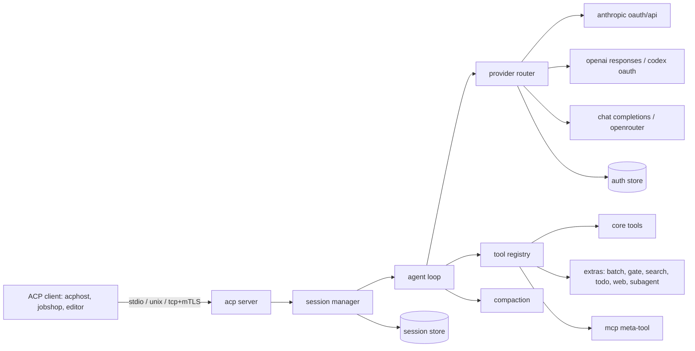

# towa design

towa is a Go coding agent that speaks the Agent Client Protocol (ACP). It runs Claude and GPT models over the user's subscriptions and other models over OpenAI-compatible APIs, with one tool set and one system prompt of its own, and adds a small set of jcode harness features. It targets hundreds of concurrent sessions per Linux host, run directly or behind acphost.

Status: draft, 2026-11-11. Decisions come from four Q&A rounds with the user.

## Goals

- ACP compliant agent: `initialize`, `authenticate`, `session/new`, `session/load`, `session/prompt`, `session/cancel`, `session/set_config_option` (model, mode, thought level), `session/set_mode`, `session/request_permission`, `session/update` with plans, tool calls, thoughts, commands and usage. Method names follow the pinned ACP schema, which has no `session/set_model`.
- Does real coding tasks locally as well as jcode does in a single session.
- Low footprint per session: idle sessions use no CPU and little memory.
- Claude OAuth, Codex OAuth, OpenAI Chat Completions and Responses, OpenRouter.
- One tool set and one system prompt, written in this repo and sent to every model.

## Non-goals (v1)

- TUI, sandboxing or isolation (wrappers such as acphost do that), swarm (leave room), self-learning or memory.
- macOS as a tested platform. It is a headless build target only: the tree must cross-build for `darwin/arm64`, because iOS captures run on a Mac.

## First milestone

The agent completes coding tasks locally with quality comparable to jcode and passes ACP compliance checks with real ACP clients (acphost, and jobshop's `acp-go-sdk` v0.13.5 client). jobcity integration and footprint comparison come after.

## Architecture



Packages:

| package | role |
|---|---|
| `cmd/towa` | a shim that calls `src/cli` |
| `src/cli` | CLI: `serve` (default, stdio), `login`, `logout`, `accounts`, `config`, `models`, `hosts` |
| `pkg/acp/harness` | what towa adds to ACP messages under `_meta.towa`, as types a client imports |
| `src/transcript` | the one conversation format shared by providers, tools and the store |
| `src/support/httpclient` | the one constructor for HTTP clients: proxy from the environment, system certificate pool |
| `src/config` | the typed config, its flags, and the loader for files, environment and flags |
| `pkg/acp` | our ACP layer: JSON-RPC connection, types generated from the pinned schema, transports, update mapping |
| `src/agent/session` | session lifecycle, modes, model switching, cancel |
| `src/agent/loop` | one prompt turn: stream, tool dispatch, limits, hooks |
| `src/provider` | provider interface, router, fallback, retry |
| `src/provider/{anthropic,openai,chat}` | wire clients |
| `src/auth` | account store, OAuth login and refresh, file locking |
| `src/tools` | registry, output gating |
| `src/tools/core` | the core tool set |
| `src/agent/extras` | the extra tools, which run the loop and child agents |
| `src/tools/patch` | the apply_patch format: parser and applier |
| `src/tools/mcp` | MCP client: stdio, streamable HTTP, legacy SSE, OAuth |
| `src/prompt/compact` | reactive, proactive, semantic, OpenAI native |
| `src/prompt/agentctx` | AGENTS.md, skills, extra files and directories |
| `src/store` | store interface and backends |
| `src/support/telemetry` | OTel traces and metrics, slog handlers |

`src/` is eleven groups, and a group imports only the groups above it:

| group | holds | may import |
|---|---|---|
| `config` | the configuration | nothing of ours |
| `transcript` | the conversation format | nothing of ours |
| `support` | `filelock`, `httpclient`, `telemetry` | `config` |
| `auth` | logins, tokens, credentials | `config`, `support` |
| `provider` | the provider interface, the wire clients, `router`, `models`, `providertest` | the four above |
| `sidecar` | `embed`, `jev`: the optional services beside the model | `config`, `support`, `auth`, `provider` (tests only) |
| `store` | the session store and its backends | `transcript`, `support` |
| `prompt` | `agentctx`, `compact`: what goes into a request | `config`, `transcript`, `support`, `auth`, `provider` |
| `tools` | the tool contract, one package per tool, `toolset`, `mcp` | the above except `sidecar` |
| `agent` | `loop`, `hooks`, `subagent`, `session`, `extras` | every group above |
| `cli` | commands and wiring, `listen`, `hosts` | every group above |

`src/layers_test.go` holds this table and fails when a package imports a group its own may not, in code or in a test, or sits outside a group (`docs/notes/2026-11-12-src-layout.md`).

`src/` holds packages while APIs settle. Packages move to `pkg/` when a real external caller needs them. `pkg/acp` moved on 2026-11-11: protocol7's worker imports it as the client side, so both ends share schema 1.31.0.

## Process and transports

- One process can host many sessions. The default is one process per stdio connection, which is what acphost spawns.
- Listeners: stdio (default), unix socket, TCP. TCP and unix support TLS with optional client certificate verification (mTLS) from config.
- A listener process serves many connections, each with its own sessions. Sessions in one process share the provider HTTP pool, auth store, MCP connections where config marks a server shared, the skill listing and the compiled tool schemas. The skill listing is checked against each `SKILL.md`'s modification time and size at every `session/new`. Context files are read and the system prompt is built for each session (`docs/notes/2026-11-12-shared-session-state.md`).
- Idle cost: no goroutine wakes while a session waits for a prompt. No polling timers. Timers start only for active turns, retries and refreshes.

## Configuration

One typed config struct is the source of every setting. Each key is a field with its name, default, help and constraints in struct tags, and kong turns each field into a flag, so `towa --help` lists every key. Values are layered in this order, each later layer overriding earlier:

1. Built-in defaults, from the `default` tags.
2. `/etc/towa/config.{yaml,yml,json}`.
3. `$XDG_CONFIG_HOME/towa/config.{yaml,yml,json}`.
4. Files listed in `TOWA_CONFIG` (path list, `:`-separated), and `--config` flags (repeatable).
5. Environment `TOWA_*`, `__` as the nesting separator (`TOWA_LIMITS__MAX_TOOL_CALLS=200`).
6. CLI flags. The flag is the key's own name: `--limits.max_tool_calls=200`.
7. Per-session overrides from `session/new` `_meta.towa` (allowlisted keys only: model, context files, skills dirs, limits, mode, mcp servers, compaction).

kong defines the commands and the flags and fills the struct. The loader in `src/config` reads the files with `goccy/go-yaml`, which reads JSON as well, and gives kong each key's value from the files and the environment. The application reads configuration only from the struct. A key that holds a table (`models`, `accounts`, `providers`, `hooks`, `mcp.servers`, `context.sections`) is written as YAML in a file, and as one line of YAML when it is a flag or an environment variable. A list table is one key: a later layer that sets it replaces the earlier layer's list whole. `models` holds named entries, and each file adds to it by name.

Nothing is guessed. These are errors that name the file or the variable: a key the config does not have, a value of the wrong type, a file that does not parse, a listed file that is missing, two config files in one directory, and an `TOWA_*` variable that is not a key. A file's value must have the key's type, so a number is not taken where a key holds text or a duration.

`go-playground/validator/v10` checks field constraints through `validate` tags after decoding. Configuration-specific rules, such as account references, endpoint policies and listener safety, remain explicit checks. Direct section validators use the same field constraints as the loader.

`towa config` prints the resolved config with secrets redacted and the source of each key.

Sketch. The examples in this document are YAML. A JSON file with the same keys loads the same way:

```yaml
# Each entry is provider:account/model, optionally with #effort. A session
# starts with the first and can select any of them. A request an entry cannot
# take falls back to the entries after it. As a flag the list is separated
# by commas: --models claude:work/claude-opus-4-7#medium,codex:chatgpt/gpt-5.5
models:
  - "claude:work/claude-opus-4-7#medium"
  - "claude:personal/claude-opus-4-7#medium"
  - "openrouter:main/anthropic/claude-opus-4.7"
  - "codex:chatgpt/gpt-5.5"

# The third entry is a gateway's own id, which the built-in table does not
# know. The gateway's provider entry below says what that model is. These two
# keys are the other way to say it: they give the figures of every model that
# neither the table nor a provider entry describes, all at once.
#
# A model of claude or codex that the table does not know needs neither key.
# The table holds only what no list settles: the OpenAI models, whose output
# limit no list gives. No Claude model is in it. At start towa reads the
# account's model list from the provider (Anthropic's /v1/models, the Codex
# backend's /models) and keeps it in models.json in the state directory for
# model_list_max_age_seconds, so a new Claude model works as soon as the
# account's list has it. A figure the list does not give is guessed from the
# name: a newer version of a family the table has (gpt-7-sol, when the table
# stops at gpt-6.1-sol) takes the figures of the family's newest row. The
# order is: the provider entry's models, the table, a key that is set, the
# provider's list, the name.
model_context_window: 0
model_max_output_tokens: 0

# claude:work, claude:personal and codex:chatgpt have no entry here: a login
# makes each of them in auth.json. Only an account without a stored login is
# declared.
accounts:
  - id: main
    provider: openrouter
    kind: api_key
    api_key_env: OPENROUTER_API_KEY
  - id: pod
    provider: claude
    kind: proxied_oauth   # oauth | api_key | proxied_oauth | proxied_api_key | none

providers:
  - id: openrouter
    kind: chat            # chat | responses
    base_url: https://openrouter.ai/api/v1
    # What each model is on this endpoint. A gateway names a model its own
    # way and may serve it with other limits than its maker does, so a
    # figure here outranks the built-in table. One that is left out comes
    # from where it would without the entry. max_output_tokens is sent to a
    # chat endpoint as max_tokens with every request, and an endpoint counts
    # it against the context window: give a figure that leaves room for the
    # prompt, not the largest the endpoint allows.
    models:
      - id: anthropic/claude-opus-4.7
        context_window: 1000000
        max_output_tokens: 128000
  - id: zai
    kind: chat
    base_url: https://api.z.ai/api/coding/paas/v4

context:
  default_agents: true    # ~/AGENTS.md, ~/.agents/rules/*.md, AGENTS.md from repo root to cwd
  agents: []              # more files or dirs of .md, in order, after the defaults
  agents_text: []         # inline text after agents, e.g. --context.agents_text="$(cmd)"
  default_skills: true    # ~/.agents/skills, searched first
  skills_dirs: []         # more skills dirs, in order
  system_prompt_file: ""  # replaces the built-in instructions

limits:
  max_tool_calls: 0       # 0 = unlimited
  max_wall: 0s
  max_input_tokens: 0
  max_output_tokens: 0
  max_stop_denials: 3     # how often a stop hook may keep a turn going
  max_todo_pokes: 0       # how often a turn ending with unfinished todos is sent back, with tools.todo.enabled

subagents:
  max_depth: 2            # 0, the default, gives the model no subagent tool
  max_concurrent: 4

compaction:
  mode: reactive          # reactive | proactive | semantic | off
  openai_native: auto     # auto | explicit | off

hooks:
  - event: pre_tool       # pre_tool | post_tool | prompt | stop
    tools: [Bash, shell]
    command: [/usr/local/bin/check-cmd]
    timeout: 5s

mcp:
  servers:
    - name: linear
      transport: streamable_http   # stdio | streamable_http | sse
      url: https://mcp.linear.app/mcp

telemetry:
  otel: true
  pprof:
    address: 127.0.0.1:6060   # Go's profiling pages, loopback only, off when empty
  logs:
    stderr:
      level: info
      format: text
    otel:
      level: debug
```

Defaults for limits and compaction thresholds start from jcode's measured defaults and are documented with their source.

## Providers and auth

### Provider interface

One streaming interface returning a normalized event stream: text deltas, thinking deltas (with signatures where the API has them), tool call starts, argument deltas, tool call ends, usage, stop reason, and provider-native items that must round-trip (Anthropic thinking signatures, OpenAI encrypted reasoning, compaction items). The stream is a Go iterator (`iter.Seq2[Event, error]`), as in `gfx-labs/sse`. A provider error is classified as one of three: retry the same chain entry, fall back to the next entry, or fail the turn.

A tool's result is stored before a request is built from it, so a client never refuses a stored result for what it holds. A part the API has no form for is replaced by a line that says what the tool returned and that it was left out (`provider.LeftOut`, `docs/notes/2026-11-12-tool-result-parts.md`). The same part in a prompt is an error, because a prompt is refused before it is stored.

Wire clients:

- `anthropic`: Messages API, streaming, OAuth or API key. A request asks for adaptive thinking with a summarized display (`claude.thinking`, `claude.thinking_display`), because thinking arrives without text otherwise and a client is shown nothing. A model the built-in table marks as without adaptive thinking is sent no thinking parameter (`docs/notes/2026-11-12-claude-thinking.md`). OAuth identity follows jcode's code and its probe (`docs/ANTHROPIC_OAUTH_IDENTITY_PROBE_2026_11_05.md` in jcode). The one required piece is the `x-anthropic-billing-header` text sent as the first system block (`cc_version=2.1.280; cc_entrypoint=...; cch=33f85;`), which Anthropic strips server-side, with jcode's OAuth beta header set. Without that block, Opus and Sonnet OAuth requests get HTTP 429. jcode sends its own user agent (`jcode/<version>`) and no `x-app`, `X-Stainless-*` or Claude Code session headers, because the probe found none of them are needed. towa sends `towa/<version>`, and the prompt names the agent as towa. jcode's branches differ on `cc_entrypoint` (`sdk-cli` on origin/master 8e11eb23e, `jcode` on build 037163c7b), so step 3 re-runs the probe before choosing.
- `openai`: Responses API, streaming. Codex OAuth through `chatgpt.com/backend-api/codex` with towa's own instructions and function tools, as jcode does. jcode's 2026-11-05 probe found the backend accepts any `originator`, so towa sends `towa`. API keys against `api.openai.com` or any Responses-compatible endpoint. Native compaction.
- `chat`: Chat Completions, streaming, for OpenRouter, z.ai, DeepSeek, OpenCode Go and others. OpenRouter extras: provider routing preferences, reasoning parameters, `HTTP-Referer` and `X-OpenRouter-Title` (the header OpenRouter's app attribution page documents). A tool message is text, so an image or audio a tool returned goes in a user message after the run of tool results, and a call's arguments always go back as a JSON object (`docs/notes/2026-11-12-chat-tool-result-images.md`, `docs/notes/2026-11-12-chat-call-arguments.md`).

Model metadata (context window, max output) comes from a pinned table plus provider model listings (`/models` on OpenRouter), with config overrides. An unknown model with no metadata is an error at selection time, not a silent default.

### Accounts and fallback

- Logins live in one file, `$XDG_STATE_HOME/towa/auth/auth.json`, mode 0600, apart from the configuration. It holds every OAuth account by id with its provider and tokens. An account in it needs no `accounts` entry: a login creates it. A model chain may name an account of a built-in provider before its first login, and a turn that reaches it then reports that the account is not logged in and gives the command. `accounts` in the configuration is for what has no stored login: API keys read from the environment and proxy-held accounts. `logout` removes the account's entry.
- Accounts without a credential (`none`): for a configured endpoint that takes no key, such as a model server on the local network. No `Authorization` header is sent, on the chat and the responses client and for embeddings. The built-in `claude` and `codex` providers refuse the kind, since both always take a credential. A refusal from such an endpoint is an auth stop, as there is nothing to refresh (`docs/notes/2026-11-12-keyless-accounts.md`).
- Proxy-held accounts (`proxied_oauth`, `proxied_api_key`): the harness never holds or refreshes the token. It sends a placeholder that names the account and builds the rest of the request exactly as for a token it held, including the Claude OAuth billing block and beta headers, because the proxy only swaps the authorization. Such an account has no entry in `auth.json`, `login` refuses it, and a rejected credential is reported as an auth stop, since there is nothing to refresh.
- Every HTTP client honours `HTTPS_PROXY` and the system certificate pool: providers, the OpenAI WebSocket transport, remote MCP, webfetch, embeddings, Jev and OTLP. They all come from `src/support/httpclient`, lint forbids building a transport anywhere else, and one CI test runs a turn through a test proxy with its own CA.
- `towa hosts` lists the hosts the resolved config will contact (providers, OAuth endpoints, MCP servers, embeddings, Jev, OTLP), one per line with the config key that names it. It builds an egress allowlist without guessing. webfetch targets are chosen by the model and cannot be listed.
- `towa usage` asks each subscription account's provider how much of its limits is used and when they reset, and prints one line per limit (`--account <id>` for one account, `--json` for a JSON array). Claude is read from `/api/oauth/usage` and a ChatGPT login from `/backend-api/wham/usage`, on the hosts the providers already use. An API key account has no subscription and is not listed.
- `towa login <provider> --account <id>` creates the account when it is new and logs it in. It prints the authorize page and opens a browser, which a local callback ends. A host without an opener still prints the page, and the login waits. `--manual` opens nothing and takes the code the page ends on. `--device` (Codex only, as upstream has no device grant for Claude) prints a one-time code and the page to enter it on, then waits for the approval, with the requests of `codex-rs/login/src/device_code_auth.rs` at the pinned commit.
- A browser or manual login is recorded under `auth/pending/<provider>.json` before its page is shown. A later run, `towa login <provider> --code '<code or address>'`, finishes it: the record names the account, so that run needs only the provider. There is one record per provider, a new login replaces it, and a finished login removes it. A manual login whose input is empty or closed leaves the record and exits, which is how a script or an agent starts a login that a person finishes.
- Refresh: take an `flock` on the account's lock file (`account.<id>.lock`, not `auth.json`, since the rename that writes the file would leave a lock on the old inode), re-read the account, refresh only if the token is still expired, write, release. Hundreds of processes share one refresh, and the refresh of one account does not wait for another's token request. Every write of `auth.json` takes `auth.json.lock` for its read and its write, so that two accounts written at once both survive, and replaces the file atomically (temp file and rename). A read takes no lock.
- Models: `models` is one ordered list of `provider:account/model`, each optionally with `#effort` (`docs/notes/2026-11-12-flat-models.md`). A session selects an entry by its text and starts with the first. The selected entry's chain is itself and every entry listed after it, so a fallback can reach another account or another model. An entry's effort is sent with a request to that entry, and an entry without one sends none. The router tries the next entry on rate limit, quota exhaustion, auth failure or overload, after retries on the current entry are exhausted. Fallback moves are reported to the client.
- Retry: exponential backoff with jitter, honoring `retry-after` and provider reset headers. Policy in config.
- Rate-limit state is per account and shared in process. Cross-process sharing is a later option (a small file or broker) if contention shows up.

### Runtime model selection

- `session/new` uses `_meta` or the configured default.
- `session/set_config_option` with the `model` category switches between turns. The session advertises the entries of `models`, in list order, as a select option. Plain messages and structural tool calls remain portable. Opaque replay requires an exact canonical provider, wire model and configured account match. Incompatible optional thinking is omitted; required signatures and native context fail explicitly or are regenerated from retained source before a request is sent.
- Subagent spawns may name an entry of `subagents.models`, each of which is an entry of `models`.

## Tools

### Core tools

Every model gets the same tools and the same instructions. There is no per-family tool shape: jcode sends its own tool names and instructions to the Claude and ChatGPT subscription backends and both accept them, so copies of Claude Code's and Codex's prompts and schemas bought nothing and cost a capture pipeline, three adapters and a rule that a chain could not mix families (`docs/notes/2026-11-11-drop-dialects.md`).

| tool | does |
|---|---|
| `read` | a text file as it is, without line numbers, or an image |
| `write` | create or replace a whole file |
| `edit` | replace exact strings in a file, several in one call |
| `apply_patch` | add, update, move and delete files from one patch |
| `bash` | run a shell command |
| `todo` | the plan, sent to the client as ACP `plan` updates (off by default) |

Names, descriptions and schemas are in `src/tools/core/specs`. The instructions are `agentctx.Instructions`. A tool's limits come from `[tools]` configuration.

`write` and `edit` refuse a file the session has not read, or one that changed since. `apply_patch` does not need the read: the hunk's context lines must match the file, which is the same check.

`edit` takes `file_path` and `edits`, a list of `old_string`, `new_string` and `replace_all`. There is no form with one replacement at the top level: a model given two ways to say the same thing uses the one it has seen most, and that was one replacement per call. The edits are applied in order, each to the result of the ones before it, and nothing is written unless all of them apply. A failure names the edit by its index. `edit` changes a file that exists, and `write` creates one (`docs/notes/2026-11-12-multi-edit.md`).

### Extras (on by default, each can be disabled)

- Parallel execution of tool calls emitted in one message. Read-only tools run concurrently; writes to the same path serialize.
- `batch`: run several independent tool calls in one call, for models that do not emit parallel calls.
- Output gating: results over a configured token budget return a summary with the estimated size; re-running with `accept_large_output` returns the full result.
- Search: there is no search tool. The model finds files and searches them with `rg`, `find` and `ls` through `bash`, as pi's does, and the prompt says so. `glob` and `grep` were removed on 2026-11-12 (`docs/notes/2026-11-12-no-search-tools.md`).
- Todo: the `todo` tool maps to ACP `plan` updates. Its input is jcode's: the list, a `plan` (the user's intention and how well it is understood) and `goals` (the feedback loop for each goal, its coverage, relevance and traceability, delivery state and when to stop). The model fills the assessment in and nothing scores it. A turn that ends with unfinished items is sent back to them up to `limits.max_todo_pokes` times. Both are off by default (`tools.todo.enabled`, `limits.max_todo_pokes: 0`).
- Off by default: `todo`, `webfetch`, `websearch`, `subagent` and `conversation_search`. A tool's definition is sent with every request, and `todo`, `webfetch` and `subagent` were about 2,000 tokens of each one (`docs/notes/2026-11-12-token-use.md`). `tools.todo.enabled`, `webfetch.enabled`, `websearch.enabled`, `subagents.max_depth: 1` and `conversation_search.enabled` turn them on.
- A tool result with nothing in it, such as a command that printed nothing, reaches the model as "The tool call returned no output." A provider refuses an empty part.
- A text block with no text is left out of a prompt for the same reason. A prompt with nothing left is refused as invalid params and nothing is stored (`docs/notes/2026-11-12-empty-prompt-part.md`).
- Web: webfetch with HTML to Markdown, off by default. Web search is off by default too (`websearch.enabled`). Turned on, it has two forms, chosen per chain entry (`docs/notes/2026-11-12-hosted-websearch.md`):
  - Hosted (`websearch.hosted`, on by default): an entry on the built-in `claude` or `codex` provider is sent the provider's own `web_search` tool in place of ours, and the provider runs the search. Its items are stored whole and go back only to the provider, model and account that made them. Any other request gets them as text. The client is shown each search as a tool call.
  - Local: every other entry gets `websearch`, where this process posts the query to DuckDuckGo's HTML page (`websearch.endpoint`) and returns titles, URLs and snippets. A bot challenge from the endpoint is reported to the model as a failed search (`docs/notes/2026-11-11-websearch.md`).
- Conversation search: a `conversation_search` tool with jcode's shape (`query`, `turns` range, `stats`), off by default (`conversation_search.enabled`, `docs/notes/2026-11-12-slim-instructions.md`). It reads the session's full stored history, including entries from before any compaction, not the compacted context the model currently sees. It can also read other sessions by id, so a parent can read the sessions of the subagents it spawned. Scope is a config setting: `self`, `descendants` (the session and every subagent session below it, the default) or `store` (every session in the store, opt-in because a shared store holds other workers' sessions). Keyword matching first. Result and snippet limits come from config.
- Argument repair: before validation, a tool input is repaired when a list or object argument arrives as a JSON string, a single object arrives where a list is declared, or a number or boolean arrives as a string. Each repair is counted in telemetry and logged, never silent. Anything else that fails the schema is returned to the model as an error.
- Subagent: see below.

Not in v1: background shell tasks.

### Subagents

The tool runs a child agent loop in the same process. Each child opens its own runtime with a read-authorization tracker, frozen tool inventory, MCP manager and compaction state. It inherits the parent's turn settings, including MCP server declarations, and may select another model or chain. The process shares provider clients, auth and child admission. Only configured MCP servers explicitly marked shared reuse physical connections; session overrides do not. The child runtime closes after its turn and tool dispatch have stopped, without closing its parent's resources. Its transcript is stored as its own session with the parent id, so the parent can search it. The parent receives the child's final message and reported usage, including usage reported before a child failure. Depth and concurrency limits come from config. Child activity streams as nested tool call updates. Swarm with separate sessions comes later.

### MCP

- Transports: stdio, streamable HTTP, legacy HTTP+SSE. OAuth for remote servers with tokens in the auth store.
- Servers come from config and from `session/new` `mcpServers`, merged by name with the session winning. A session's server replaces a configured server of the same name whole; no field is merged.
- One `mcp` meta-tool with `list`, `search` (names and descriptions) and `call`. Schemas are returned on search, not loaded into the prompt.
- Direct tools: a server marked `direct` has its tools put in the prompt under their own names, not behind the meta-tool. A server named in `session/new` `mcpServers` is direct by default, since the client added it for this session and its tools (`submit_result`, `ask_human`) are used every turn. A config server is behind the meta-tool by default. A direct tool whose name collides with another tool is an error at session start. The direct tools are fixed when the session starts: a server that changes its tool list later does not change the prompt.
- Connections start lazily on first use and close after an idle period from config.

### Permissions and modes

- Modes: `auto` (default, allow all, like jcode) and `ask` (routes `session/request_permission` for tools marked writing or executing). Exposed through ACP session modes.
- Slash commands through `available_commands`: `/compact`, `/model`, `/mode`, `/cost`.

### Hooks

Config maps an event and a tool set to a command. The command gets the event as JSON on stdin and returns JSON: allow, deny with reason, or modified input. Events: `pre_tool`, `post_tool`, `prompt`, `stop`. Timeouts come from config.

### Limits

Per-prompt limits from config or `_meta`: max tool calls, wall time, input and output tokens, subagent depth and concurrency. Hitting a limit ends the turn with a stop reason the client can see. Cancellation through `session/cancel` stops the stream, kills running tool processes by process group, and records the outcome of each in-flight tool as completed, cancelled or unknown.

### Interruption

- A `session/prompt` that arrives while a turn is running cancels that turn and starts the new one, as `acp-go-sdk` v0.13.5 does. The cancelled request returns the `cancelled` stop reason.
- After a cancel, every in-flight tool call gets a result saying it was cancelled, so no tool call is left without a result.
- The model is then told the turn was interrupted: `agentctx.Interruption` is placed as a user message before the next user message. It says the user interrupted on purpose and that a running command may have partly run.

## Compaction

Ported from jcode:

- `reactive`: compact in the background when context reaches a fraction or a token count, with emergency hard compaction when a request would not fit.
- `proactive`: project growth with EWMA over a lookahead window, with floor, sample, stall and cooldown settings.
- `semantic`: topic-shift detection and relevance keeping with embeddings from a configured embedding provider (see Embeddings).
- `off`: stop the turn with a context-full reason.
- OpenAI native: `auto` (server-side compaction at a token threshold), `explicit` (call the compact endpoint at the threshold), `off`.
- `max_context_tokens` caps the budget below the model window.
- `/compact` triggers manually. Compaction is reported with `compaction_update` when the client advertises `session.compaction`, and as an ordinary agent message otherwise.
- Compaction appends an entry holding the summary and the id of the first kept entry. It never rewrites or deletes earlier entries, so conversation search can still read them.
- Two summary prompts, selected by `compaction.summary_prompt`: `checkpoint` (default, Pi's structured format with its merge prompt for later compactions) and `short` (jcode's). Either one tells the model it can search earlier history only when `conversation_search` is enabled.

## Embeddings

One client for the OpenAI `/v1/embeddings` shape, configured by base URL, model, account and dimensions. No in-process model. Local embeddings run as a sidecar that serves the same API: Ollama, llama.cpp `llama-server --embedding`, Hugging Face TEI, or Infinity. Hosted options use the same client: OpenAI, OpenRouter, Voyage, Jina, Mistral, Gemini through its OpenAI-compatible endpoint. Providers with a different wire shape get an adapter only when needed.

Recommended sidecar: Hugging Face Text Embeddings Inference (TEI). It runs any supported Hub model by id and serves OpenAI-compatible `/v1/embeddings`:

```sh
docker run -d -p 8080:80 -v $HOME/.cache/tei:/data \
  ghcr.io/huggingface/text-embeddings-inference:cpu-latest \
  --model-id BAAI/bge-small-en-v1.5
```

```yaml
embeddings:
  base_url: http://127.0.0.1:8080/v1
  model: BAAI/bge-small-en-v1.5
```

## Jev decisions

A configured Jev endpoint backs a native `jev_decision` tool and skill: bounded choice among supplied options, with state treated as untrusted data, matching jcode's tool shape and limits. Routes follow jcode: OpenRouter decisions, TypeSafe direct, AIMLAPI, or a custom base URL. Jev serves decisions only, not embeddings, so embeddings stay a separate config. Harness features may use Jev later (skill suggestion, subagent model routing) behind config.

```yaml
jev:
  route: openrouter     # openrouter | typesafe | aimlapi | custom
  model: typesafe/jev-1.13
  account: main
```

## System prompt

The prompt is built from named sections in a fixed order: the instructions (built in, or `context.system_prompt_file`), tools, rules, project context, skills, working directory, and any sections added by config. The instructions are plain text. Every section after them is sent inside a tag of its name (`<tools>`, `<rules>`, `<project_context>`, `<skills>`, `<working_directory>`, a configured section's own name), and each context file is inside `<project_instructions path="...">` within the project context. This is pi's layout (`docs/notes/2026-11-12-prompt-sections.md`). The instructions are four lines: that it is an efficient and accurate coding assistant, to follow the user's instructions and the project rules, to ask only for a decision that is the user's because sessions often run unattended, and not to claim a result it has not observed. They do not name the harness. They say nothing about how much to check or when the task is finished, which the project's own rules cover (`docs/notes/2026-11-12-slim-instructions.md`). The tools and rules sections are built for each chain entry from the tools that entry is sent, so the prompt never names a tool the model does not have. The tools section has one line per tool, its name and `tools.Tool.Summary`. The rules section has each enabled tool's guidance lines (`tools.Tool.Guidance`), then `agentctx.GeneralRules`. The `bash` tool's rule says to use it for file operations like `ls`, `rg` and `find`, since there is no other tool for them. The `edit` tool's rules say to change several places of one file with one call, that each `edits[].old_string` is matched against the file as the earlier edits left it, so edits must not overlap and nearby changes go in one edit, to keep `edits[].old_string` small but unique and not pad it with unchanged text, to read a file with `read` before the first edit, that a file stays editable after the session's own edits until a command changes it, and to change files with `edit`, `apply_patch` or `write` and not with `sed`, `perl` or Python scripts in `bash`, which would skip the edit checks and the diff a client is shown. An entry with hosted search gets the lines of the provider's search tool. The rule that a command has no terminal is one of the `bash` tool's lines and is also in its description (`docs/notes/2026-11-12-prompt.md`). ACP `systemPrompt` on `session/new` maps onto them: `append` adds a section, and `override` replaces the instructions, tools and rules and leaves the tool definitions, MCP servers and permissions alone. An unsupported mode is an error. Appending a changed section mid-session to keep the prompt cache is deferred until a measurement shows sections change mid-session.

## Context loading

- AGENTS.md from the working directory up to the repository root, plus the global file.
- Skills: directories with `SKILL.md`, listed by name and description in the system prompt and loaded on demand by a `skill` tool.
- Extra files and directories from config or `_meta`.
- All of it is read when the session opens, and every turn uses that copy. The copy is in memory only: `session/new`, `session/load`, `session/resume` and `session/fork` each read the files again, so a loaded or resumed session continues with changed rules. Between two opens the prompt stays the same from turn to turn, which keeps the provider's cached prefix.
- The system prompt built from it is kept on the session's runtime as well, one for model entries whose web search is the provider's own and one for the rest. It is built again only when one of its inputs differs from what the kept one was built from, which happens when the session's MCP tools arrive.

## Sessions and storage

Store contract (`src/store/store.go`):

```go
type Store interface {
    Create(ctx context.Context, meta Meta) error
    Append(ctx context.Context, id uuid.UUID, entries []transcript.Entry) error
    Load(ctx context.Context, id uuid.UUID) (Meta, iter.Seq2[transcript.Entry, error], error)
    History(ctx context.Context, id uuid.UUID, r Range) (iter.Seq2[transcript.Entry, error], error)
    Repair(ctx context.Context, id uuid.UUID) (setAside int64, err error)
    Fork(ctx context.Context, source uuid.UUID, meta Meta) error
    SetMeta(ctx context.Context, meta Meta) error
    List(ctx context.Context, filter Filter) ([]Meta, error)
    Delete(ctx context.Context, id uuid.UUID) error
    PutBlob(ctx context.Context, id uuid.UUID, mimeType string, content io.Reader) (transcript.Stored, error)
    OpenBlob(ctx context.Context, id uuid.UUID, hash string) (io.ReadCloser, error)
}
```

- `transcript.Entry` is the append-only canonical transcript: messages, tool calls and results, provider-native items, model switches, compaction summaries. Provider-only content is in `Item.Opaque`, tagged with canonical `Item.Provider` and `Item.Origin` (exact request model and configured account ID). Opaque replay requires all three identities to match. A legacy nil origin is unknown and is never inferred or backfilled. Only safe plain structural fallback is allowed without a match, required signatures and native context need an explicit incompatibility error or portable regeneration from retained source.
- Session and entry ids are caller-supplied UUIDv7 from the Go standard library. Times also come from the caller. Each entry keeps its `ParentID`, including when a fork copies it.
- `Meta` records cwd, additional directories, title, model, mode, parent session id, created time and archived state. `State` is opaque caller-owned bytes for session configuration the load request cannot carry. The store returns those bytes unchanged and never interprets them. `SetMeta` replaces Title, Model, Mode, Dirs, Archived and State, leaving identity, cwd, parent and created time unchanged.
- `Append` returns only after the entries are durable, all together. In either format, a crash leaves a complete append or an explicitly torn one, never a silently accepted prefix. `Updated` is the time of the last entry, read from the log rather than rewriting metadata each turn.
- `Load` yields the latest `Compaction` entry and everything after it, without reading the history before it. There is no separate snapshot method. `History` selects entry positions from the full log, including entries before compaction.
- A torn log yields its complete entries followed by an error matching `store.ErrTorn`. `Append` refuses the same log. The session layer calls `Repair`, which durably sets the torn bytes aside under a unique name before cutting back the log, then reloads. Repair does not delete any set-aside bytes.
- The first backend is `src/store/dir`: one directory per session, metadata plus an append-only JSON-lines log and `blobs/`. `store.compression` defaults to `zstd`, one frame per append, and `none` is available. The plain log closes each append with a commit line. Both are one write and one fsync per append. Files and their directories are synced when created. `store.fsync` is on by default; off, the store calls fsync for nothing, and a crash of the machine can lose or tear the last writes. Existing sessions keep their format when the setting changes.
- Large outputs are stored by SHA-256 beside the log and referenced by `Part.Stored`. `PutBlob` is durable, deduplicates within a session, and `OpenBlob` checks the digest as the content is read. The model gets the preview part, not the stored reference.
- Everything a session needs is under its directory. Copy that directory under a new root, and a new process loads it, opens its blobs and continues. The backend test does exactly that. `Fork` copies the entire source history (ACP 1.31.0 has no point-in-history parameter), preserves entry ids, and uses the caller's new `Meta`. Blobs are hard linked because they are immutable, or copied across filesystems. Deleting either session leaves the other complete.
- `List` is ordered by id, oldest first. `Filter` combines Cwd, ParentID and archived state before applying its exclusive `After` cursor and caller-supplied `Limit` (zero is unlimited). ACP's omitted archive filter maps to `ArchivedExclude`; the store's zero filter matches all sessions. Parent lookup uses a rebuildable root-level children index, invalidated by root directory changes, not a scan of every session on every descendant lookup. The index is not session state and is rebuilt after directory copies.
- `dir.Store.Sweep` is called on demand at startup, not from `New`. It removes abandoned `.creating` and `.deleting` directories. Namespace changes take the root directory lock, and per-session operations take the log lock. No caller acquires the root lock while holding a log lock.
- `session/load` replays full history as `session/update` notifications. SQLite, Postgres, blob garbage collection and a plain-log offset index are not implemented.

Measured on Linux/btrfs/NVMe, 2000 turns and 36000 entries (58.9 MiB of JSON). One append per turn, reads on a fresh store value. The benchmark harness accepts any `store.Store` and measures appends, fsyncs, bytes written, disk size, load, history ranges and keyword scans. Full commands and limitations are in [the store note](notes/2026-11-11-store.md).

| measurement | plain | zstd |
|---|---|---|
| fsyncs per turn | 1 | 1 |
| disk size | 59.0 MiB | 20.6 MiB |
| p50 append per turn, compacted workload | 1.85 ms | 2.08 ms |
| load with no compaction | 444 ms | 360 ms |
| load after latest compaction (19 entries) | 371 µs | 409 µs |
| keyword scan, full history | 306 ms | 452 ms |

The final run had substantial fsync variance from concurrent system activity. Its first plain append pass averaged 11.8 ms, versus 2.78 ms for its compacted pass. The note reports both rather than treating that difference as a compression speedup.

At 10000 sessions, unfiltered `List` took 258 ms warm / 316 ms file-data-cold before paging. After the change its first 50 results take 4.71 / 5.46 ms. Full child lookup (100 matches) went from 243 / 314 ms to 2.52 / 3.89 ms. Initial children-index construction is separate: 126 ms with warm files. File-data-cold means `POSIX_FADV_DONTNEED` on the files, not evicted directory or inode caches.

## ACP mapping

| internal | ACP |
|---|---|
| text delta | `agent_message_chunk` |
| thinking delta | `agent_thought_chunk` |
| tool call | `tool_call` with kind, title, locations, raw input; `tool_call_update` with status, content, diffs |
| todo | `plan` |
| commands | `available_commands_update` |
| mode | `current_mode_update` |
| usage and cost | `usage_update` (context used, context size, cost) and `usage` on the prompt response |
| model, mode, thought level | `config_option_update` |
| active account, fallback, compaction, limit hit | `_meta.towa` on the relevant update, and the prompt response `_meta` |

Stop reasons map to ACP `end_turn`, `max_tokens`, `max_turn_requests`, `refusal`, `cancelled`.

ACP has no stop reason for a rate limit. A turn that stops for a reason the client can act on carries a typed `stop` under `towa` (`pkg/acp/harness`): `kind` is one of `rate_limit`, `auth`, `overload`, `context_full`, `limit`, `network`, `request`, `denied`, with `resetAt`, `retryAfterSeconds`, `limit`, `account` and `model` where they apply. It is in the prompt response's `_meta` when the turn has a stop reason (a limit answers `max_turn_requests`) and in the error's `data` when the turn failed. A client never has to parse error text. protocol7 treats `rate_limit` as a deferral. `denied` means a configured prompt hook refused the prompt: the turn did not start, the request answers `-32600`, and `message` is the hook's reason.

A chain with one entry does not wait out a rate limit: it reports it. In a pod, the workflow that owns account choice decides whether to wait or move.

## ACP layer

towa implements ACP itself and does not import `coder/acp-go-sdk`.

- Why: SDK v0.13.5 (2026-06-02) is generated from schema 0.13.5 and its master still pins that. The spec is at v1.17.0, schema 1.31.0 (2026-11-10). The SDK has no types for stable `compaction_update`, `compaction_summary_chunk`, `notice` and `systemPrompt`, and none for unstable `subagent_update`, `session/status` and `session/options`.
- Types: generated from the pinned schema files (`schema.json`, `schema.unstable.json`, `meta.json`) by a vendored copy of the SDK's generator (`cmd/generate`, Apache-2.0, about 3,700 lines, one dependency: `dave/jennifer`). We fix the generator where the new schema breaks it.
- Generator check, 2026-11-11: run unchanged against schema 1.31.0, it emitted every new type and update variant. Three generator bugs are fixed in our copy: `CreateElicitationRequest.Validate` read a `Message` field that the new union type does not have, every empty required string was rejected (so an empty file could not be written), and union marshalling carried unreachable code that `go vet` reports. `tools/acpgen/README.md` lists every change from upstream.
- Connection: our own JSON-RPC 2.0 code for newline-delimited messages (`pkg/acp/connection.go`). Each request runs on its own goroutine. Notifications and responses are handled in the order read. `$/cancel_request` cancels the named request's context. `Arrival(ctx)` gives a message's position in the read order, which is how the session owner orders a `session/cancel` or a new prompt against the running one. Details and reasons: `docs/notes/2026-11-11-acp-layer.md`.
- Capability gating: an update type is sent only when the client advertises it. Measured against SDK v0.13.5 on 2026-11-11: it decodes `compaction_summary_chunk` as a user message chunk, and decodes `compaction_update`, `notice` and `subagent_update` as a session info update. All of them pass its validation, so an old client misreads them without an error.
- The schema version is pinned in the repo. A bump is a reviewed regeneration.
- ACP v2 is in alpha (schema 2.0.0-alpha.15) and drops `session/load`, `session/set_mode` and `fs/*`. Owning the layer lets one binary serve both versions later.

## Ideas from Pi

From `earendil-works/pi` (MIT) at commit 4839e41, read 2026-11-11. Decided with the user on 2026-11-11.

Adopted:

- System prompt as named sections (see System prompt). Patching a changed section into the conversation is deferred.
- Tool input repair (see Extras), widened from Pi's edit tool to every tool.
- Entries with `id` and `parent_id` (see Sessions and storage). The parent field is written and unused.
- Compaction summary prompt (see Compaction): Pi's structured checkpoint (Goal, Constraints, Progress, Key Decisions, Next Steps, Critical Context) and its merge prompt are the default, with jcode's short prompt selectable. No measurement compares them yet.

Dropped:

- Steering and follow-up queues. jobshop already holds a message for a busy session until its turn ends, and its interrupt option cancels the turn first. The ACP prompt request has no steering field.

Later, undecided: MCP exposure levels per tool, virtual models, cache warming, prompt templates.

## Telemetry

- OpenTelemetry traces: span per prompt turn, provider request (model, account, tokens, retries, fallback), tool call, MCP call, compaction, subagent.
- Metrics: active sessions, turns, tokens by provider, account and model, cost, request latency, retries, fallbacks, tool latency and errors, compaction counts, RSS and goroutines.
- slog for logs. Stderr handler and OTel log handler are configured separately (level, format, enabled). Trace and span IDs are attached to records.
- OTLP endpoint and headers through the standard `OTEL_*` environment variables plus config.

## Code conventions

- Go 1.27.3 with `CGO_ENABLED=0`. Packages start in `src/`, with deliberate promotion to `pkg/` for external callers.
- JSON is `encoding/json/v2` with `jsontext`, enforced by lint. Per-message buffers come from `valyala/bytebufferpool` where a benchmark shows it saves memory. The measured behaviour is in `docs/notes/2026-11-11-contracts-and-conventions.md`.
- kong is the CLI and fills the config struct. Config files are YAML or JSON, read with `goccy/go-yaml`. The reasons and measurements are in `docs/notes/2026-11-11-kong-config.md`.
- golangci-lint v2.15 with acphost's configuration and gofumpt.
- Plain Go concurrency: contexts for cancellation, one owner for session state, channels for coordination, and small scoped mutexes for shared state where needed. No blanket lock-free rule.
- Keep concrete types until a consumer needs an interface. Prefer small consumer-owned interfaces, explicit errors, and valid zero values where meaningful. Model lifecycle transitions explicitly without adding a sum-type framework.
- Limits come from caller configuration, protocol requirements or measurements. Configured provider fallback is intentional policy, not silent error recovery.
- Short dated notes in `docs/notes/` record decisions and dependency rationale. Comments explain non-obvious constraints.

## Workflow

- Commits go straight to master until the first milestone. After that: PRs with conventional titles, and release-please.
- CI runs on the `talos-metal-gfx` runner with acphost's steps: build, a `CGO_ENABLED=0` build, vet, race tests, golangci-lint v2.15.0, and a check that generated code is current.
- Parallel packages may be built by swarm workers once the core loop works: `claude-fable-5-2` at low effort on the `claude-panda` account.

## Release

- Private repo `gfx-labs/towa`, Go module `github.com/gfx-labs/towa`. The binary is `towa`, built from `cmd/towa`. The same word names the config and state directories, the `TOWA_` environment prefix, the `_meta` key and what is sent to providers. The name is the Towa Organization of Boogiepop Phantom.
- release-please, static binaries (`CGO_ENABLED=0`, linux amd64 and arm64), Nix flake with the package and a NixOS or home-manager module later.
- Dependencies: `alecthomas/kong`, `goccy/go-yaml`, OTel Go SDK aligned with jobshop and `otelslog`, `modelcontextprotocol/go-sdk`, `gfx-labs/sse`, `valyala/bytebufferpool`, `coder/websocket`, `klauspost/compress`, `golang.org/x/sys`, `JohannesKaufmann/html-to-markdown/v2` for webfetch. Provider wire clients use `net/http`, `gfx-labs/sse` for SSE decoding, and `coder/websocket` for the OpenAI WebSocket transport. New dependencies need a recorded reason.

## Validation

- ACP compliance: a conformance suite driving the agent over each transport, with our own client and with `acp-go-sdk` v0.13.5 as the client jobshop uses today (initialize, new, prompt, cancel mid-tool, load and replay, set_config_option for model and mode, set_mode, permission in ask mode).
- Providers: recorded real responses per provider for the stream parser. Live checks against real subscriptions run by hand behind an env flag, not in CI. No tests against mocked providers.
- Tools: each tool runs against real files and a real shell in a temporary directory.
- Tests use testify, as acphost does.
- Task quality: about 10 real closed issues from acphost and jobshop, run on towa and jcode with the same model, comparing completion, turns, tokens and wall time.
- Footprint: RSS and CPU for 1, 10 and 200 idle and active sessions, compared with jcode, measured by a reproducible script.

## Implementation order

1. Repo scaffold, config, slog and OTel, ACP server on stdio with `initialize`, `session/new`, `session/prompt`, `session/cancel`, and a stub loop. Done 2026-11-11: `docs/notes/2026-11-11-acp-layer.md` and `docs/notes/2026-11-11-config-telemetry-server.md`.
2. Chat Completions provider (OpenRouter), core tools, agent loop with parallel tools, limits, cancellation. First real tasks run here.
3. Anthropic provider with OAuth login, refresh and locking.
4. Responses provider with Codex OAuth, native compaction.
5. Model chains, fallback, retries, model switching through `session/set_config_option`, usage and cost reporting.
6. Session store interface with a first backend, `session/load`, store benchmark.
7. Extras: batch, output gating, search, todo and plan, web, subagents.
8. MCP meta-tool with all three transports and OAuth.
9. Compaction modes, embeddings client, Jev decisions, hooks, modes, slash commands, context loading options.
10. Unix and TCP listeners with mTLS, multi-session process mode.
11. Conformance suite, task quality comparison, footprint benchmark, then jobcity trial.

## Clients today

jobshop (origin/master 2b42e5fd, 2026-11-11) uses `acp-go-sdk` v0.13.5 and calls `initialize`, `session/new` with an empty MCP server list, `session/load`, `session/prompt`, `session/cancel` and `session/set_config_option`. acphost and jobshop now live under `gfx-labs`.

## Open questions

- Local web search has one backend, DuckDuckGo's HTML page, which challenges an address that searches often. A second backend (SearXNG or a keyed API) is added when that is measured to be a problem on the worker hosts.
- Hosted web search is recorded for the two OAuth backends only. The API-key endpoints of Anthropic and OpenAI have no recording.
